<div align="center">
  <h2>Jornada de Implementação — Semantic BI & NL2SQL Gateway</h2>
  <p><i>Painel Vivo de Governança Semântica, Codegen Power BI & Firewall AST NL2SQL</i></p>
  <p><b>Versão:</b> 1.0.0 &nbsp;|&nbsp; <b>Última Atualização:</b> 2026-11-23 &nbsp;|&nbsp; <b>Padrões:</b> ADR-001 • ADR-002 • ADR-003 • C.O.R.E.</p>
  <hr/>
</div>
<br/>

# Jornada de Implementação & Painel Vivo de Governança

> **Single Source of Truth (SSOT):** Renderizado deterministicamente a partir de [`state/project_progress.json`](state/project_progress.json) via `python scripts/render_progress.py`. Não editar manualmente.

## 1. Painel Executivo em Tempo Real

- **Última Fase Concluída / Ativa:** `Fase 04 — Text-to-SQL Governado & AstSqlFirewall Completo`
- **Status Geral:** `ON_TRACK`
- **Progresso Estrutural:** **5 de 9 Fases Concluídas (55.6%)**

```mermaid
flowchart LR
    F00["Fase 00: CONCLUIDO"]
    F01["Fase 01: CONCLUIDO"]
    F00 --> F01
    F02["Fase 02: CONCLUIDO"]
    F01 --> F02
    F03["Fase 03: CONCLUIDO"]
    F02 --> F03
    F04["Fase 04: CONCLUIDO"]
    F03 --> F04
    F05["Fase 05: PENDENTE"]
    F04 --> F05
    F06["Fase 06: PENDENTE"]
    F05 --> F06
    F07["Fase 07: PENDENTE"]
    F06 --> F07
    F08["Fase 08: PENDENTE"]
    F07 --> F08
```



---

## 2. Cronograma de Fases (1 PR por Fase)

| Fase | Escopo | Branch | Status | Conclusão | Entregáveis & Gate |
| :---: | :--- | :--- | :---: | :---: | :--- |
| **Fase 00** | **ADRs Fundacionais & Contrato Semântico (metrics.yaml)** | `docs/phase-00-adrs-and-semantic-schema` | `CONCLUIDO` | `2026-11-23` | • ADR-001: compilação semântica determinística antes de LLM e prevenção de fan-out/chasm traps<br/>• ADR-002: AstSqlFirewall (sqlglot) + defesa em profundidade DuckDB somente-leitura<br/>• ADR-003: padrão determinístico de geração Power BI (DAX/TMDL, Power Query M, tema WCAG AA)<br/>• catalog/metrics_schema.json (Draft 2020-12), catalog/metrics.yaml (6 modelos, 8 joins, 8 métricas) e scripts/validate_metrics_schema.py<br/><i>Gate: ADRs revisados e schema/invariantes do metrics.yaml validados (PR #1 mergeado)</i> |
| **Fase 01** | **Fundação do Repositório, .venv, CI/CD & Renderizadores** | `chore/phase-01-foundation-ci-catalog` | `CONCLUIDO` | `2026-11-23` | • .venv isolado Python 3.12 com dependências pinadas (==) em requirements.txt e requirements-dev.txt<br/>• pyproject.toml com entrypoints sbg e sbg-mcp e esqueleto src/semantic_bi_gateway/<br/>• catalog/dax_templates.yaml, catalog/benchmark_registry.yaml e render_catalog.py (CATALOG.md)<br/>• state/project_progress.json e render_progress.py (JORNADA_IMPLEMENTACAO.md)<br/>• Workflows GitHub Actions (.github/workflows/ci.yml e pr-lint.yml), README.md e tests/test_foundation.py<br/><i>Gate: ruff, validate_metrics_schema, render_* --check, pytest e CI 100% verdes</i> |
| **Fase 02** | **Ingestor dbt & Compilador Semântico (Grafo de Joins)** | `feat/phase-02-dbt-ingestor-semantic-compiler` | `CONCLUIDO` | `2026-11-23` | • Projeto dbt sintético embarcado (dbt/, seed=42) com 11 modelos, 33 data tests e cobertura 100% no lint_dbt_docs.py<br/>• Ingestor de manifest.json, schema.yml e metrics.yaml (DbtMetadataIngestor)<br/>• Compilador semântico com grafo dirigido de joins permitidos e prevenção de fan-out e chasm traps (SemanticCompiler)<br/><i>Gate: dbt build, lint_dbt_docs.py e testes unitários (incluindo fan-out/chasm traps) verdes</i> |
| **Fase 03** | **Codegen Power BI (DAX, TMDL, Power Query M, Tema WCAG AA)** | `feat/phase-03-powerbi-codegen` | `CONCLUIDO` | `2026-11-23` | • Gerador .dax e .tmdl (52 medidas: base + YTD, YoY%, MoM%, R12M e variância vs. meta via DIVIDE)<br/>• Scripts .pq parametrizados para DuckDB, Databricks e Snowflake com contratos explícitos de tipos<br/>• corporate_theme.json WCAG 2.1 AA (>= 4.5:1), kpi_dictionary.md, validadores estruturais e golden files<br/><i>Gate: Golden files determinísticos e validadores sintáticos/WCAG AA verdes</i> |
| **Fase 04** | **Text-to-SQL Governado & AstSqlFirewall Completo** | `feat/phase-04-nl2sql-ast-firewall` | `CONCLUIDO` | `2026-11-23` | • Motor NL2SQL determinístico bilíngue PT/EN (DeterministicNl2SqlEngine) + adaptador opcional de LLM (OptionalLlmAdapter)<br/>• AstSqlFirewall (sqlglot) + ReadOnlyDuckDbExecutor com bloqueio de IO/rede, PII, Unicode NFKC e lock_configuration<br/>• Suíte adversarial completa (38 cargas bloqueadas: 100%) e testes end-to-end contra DuckDB<br/><i>Gate: 100% de bloqueio na suíte adversarial</i> |
| **Fase 05** | **Ponte Multi-Lakehouse Read-Only & Fallback Sintético** | `feat/phase-05-multi-lakehouse-bridge` | `PENDENTE` | — | • Adaptador read-only para public-data-gateway, finops-capex-revenue-lakehouse e ops-sla-telemetry-lakehouse<br/>• Client Path Shield e fallback automático para dataset sintético embarcado (seed=42)<br/><i>Gate: Execução isolada no GitHub sem dependências privadas + testes de bloqueio de escrita</i> |
| **Fase 06** | **Harness de Evals NL2SQL (50 Perguntas + Bateria Adversarial)** | `feat/phase-06-nl2sql-eval-harness` | `PENDENTE` | — | • Benchmark com 50 perguntas de negócio (PT/EN) com gabarito SQL e hash de result-set<br/>• scripts/eval_nl2sql.py com AST equivalence, result-set hash match e adversarial block rate<br/>• Piso mínimo declarado no README e imposto no CI (modo determinístico)<br/><i>Gate: eval_nl2sql.py verde no CI atingindo os pisos mínimos definidos</i> |
| **Fase 07** | **Paridade nas 4 Interfaces (SDK, CLI, FastAPI, MCP)** | `feat/phase-07-four-interface-parity` | `PENDENTE` | — | • SDK SemanticBiGateway e CLI sbg (compile-bi, ask, validate-sql, eval, kpi-dict, status)<br/>• FastAPI /api/v1/* com OpenAPI e MCP sbg-mcp com delimitadores <untrusted_data><br/>• Testes de paridade e enforcement do AstSqlFirewall em todas as interfaces<br/><i>Gate: Paridade total, firewall ativo nas 4 interfaces e quickstart <= 60s</i> |
| **Fase 08** | **Integração no C.O.R.E. (POP, Skill Inativa & Orquestradores)** | `feat/semantic-bi-nl2sql-integration` | `PENDENTE` | — | • Novo POP em core/docs/Tecnicos/Inteligencia_Artificial_ML_MLOps/ formatado (POP_T_148)<br/>• Skill inativa .agents/skills_inactive/tech-semantic-bi-nl2sql/ + tests/eval_cases.json (>= 4 casos)<br/>• Roteamento sob demanda em biz-consulting-orchestrator (Fase 6), tech-engineering-orchestrator e biz-study-orchestrator<br/><i>Gate: compile_rules, evals/engine.py --all, check_secrets e CI do core 100% verdes</i> |

---

## 3. Trilha Histórica de Marcos

| Data | Fase | Marco | Resumo |
| :---: | :---: | :--- | :--- |
| `2026-11-23` | **Fase 00** | ADRs Fundacionais & Contrato Semântico | Criação do repositório público semantic-bi-nl2sql-gateway, ADR-001..003, JSON Schema Draft 2020-12 e catálogo metrics.yaml validado via PR #1. |
| `2026-11-23` | **Fase 01** | Fundação, .venv Isolado, CI/CD & Renderizadores Determinísticos | Estrutura Python 3.12 com dependências pinadas (==), workflows CI/pr-lint, renderizadores CATALOG.md/JORNADA_IMPLEMENTACAO.md e testes de fundação. |
| `2026-11-23` | **Fase 02** | Projeto dbt Sintético, Ingestor de Metadados & Compilador Semântico | Projeto dbt DuckDB (5 seeds, 11 modelos, 33 data tests, 100% docs coverage), DbtMetadataIngestor e SemanticCompiler prevenindo fan-out e chasm traps. |
| `2026-11-23` | **Fase 03** | Codegen Power BI Determinístico (DAX, TMDL, Power Query M, WCAG AA & KPI Dict) | PowerBiCodeGenerator emitindo 52 medidas DAX/TMDL, scripts M para DuckDB/Databricks/Snowflake, tema WCAG AA e dicionário KPI validados com golden files. |
| `2026-11-23` | **Fase 04** | NL2SQL Governado Bilíngue, AstSqlFirewall & DuckDB Somente-Leitura | AstSqlFirewall (sqlglot), ReadOnlyDuckDbExecutor, DeterministicNl2SqlEngine PT/EN e OptionalLlmAdapter com 100% de bloqueio em suíte adversarial. |

---

## 4. Runbook Rápido de Verificação

```bash
ruff check .
python scripts/validate_metrics_schema.py
python scripts/render_catalog.py --check
python scripts/render_progress.py --check
pytest -m "not live" -v
```
