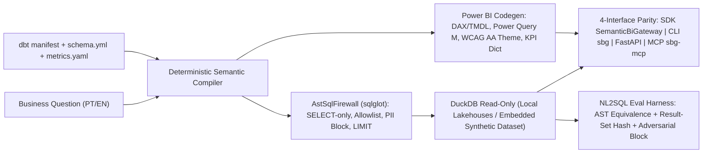

# semantic-bi-nl2sql-gateway

> **dbt semantic-layer compiler, automated Power BI (DAX / Power Query M) code generator and AST-guarded zero-hallucination text-to-SQL analytics gateway** (`Python`, `dbt`, `DuckDB`, `sqlglot`, `Power BI`, `FastAPI`, `MCP`).

> **Synthetic Data & Zero-Trust Privacy (`ADR-002` / `POP_T_154`):**  
> This public repository runs **100% offline on deterministic synthetic data (`seed=42`)** by default. It contains **zero client data**, **zero PII**, and **zero secrets**. Local multi-lakehouse read-only queries enforce a strict sensitive-column blocklist and **Client Path Shield** keeping real outputs outside this repository.

---

## 1. Architecture & Data Flow



### Core Architectural Guarantees

1. **Deterministic-First Semantic Compilation ([`ADR-001`](docs/adr/ADR-001-deterministic-semantic-compilation.md)):**
   - Compiles dbt metadata and [`catalog/metrics.yaml`](catalog/metrics.yaml) (validated against [`catalog/metrics_schema.json`](catalog/metrics_schema.json)) **before** any LLM invocation.
   - Enforces a directed typed join graph (`many_to_one`, `one_to_one`), rejecting `N:M` fan-out joins and direct `fact`-to-`fact` chasm traps (compiling multi-fact queries via independent pre-aggregated CTEs).
   - Defaults to **offline deterministic mode (`0` tokens, `0` network calls)**; optional LLM adapters remain subject to identical catalog binding and AST validation.
2. **AST SQL Firewall & Read-Only DuckDB Boundary ([`ADR-002`](docs/adr/ADR-002-ast-sql-firewall-readonly-duckdb.md)):**
   - Treats all generated SQL as untrusted input via `AstSqlFirewall` (`sqlglot`): single-statement `SELECT` only, closed table/column/function allowlist, PII blocklist (`blocked_sensitive_columns` + regex), mandatory `LIMIT`, and execution timeouts.
   - Blocks DDL/DML/utility statements (`DROP`, `ATTACH`, `COPY`, `INSTALL`, `LOAD`, `PRAGMA`) and DuckDB IO/network primitives (`read_csv*`, `read_parquet*`, `glob`, `http_*`), backed by `read_only=True`, `enable_external_access = false`, and `lock_configuration = true`.
   - Wraps MCP outputs in `<untrusted_data>` delimiters (`OWASP LLM01/LLM02`).
3. **Deterministic Power BI Codegen Standard ([`ADR-003`](docs/adr/ADR-003-powerbi-dax-m-codegen-standard.md)):**
   - Emits `.dax` / `.tmdl` measures (base + `YTD`, `YoY %`, `MoM %`, `R12M`, `Variance vs Target`), parameterized `.pq` scripts (`DuckDB`, `Databricks`, `Snowflake`), a WCAG 2.1 AA `corporate_theme.json` (`>= 4.5:1` contrast), and a Markdown KPI dictionary.

---

## 2. Quick Start (`<= 60s` Offline Setup)

```bash
git clone https://github.com/jhsfhtls/semantic-bi-nl2sql-gateway.git
cd semantic-bi-nl2sql-gateway

python -m venv .venv
source .venv/bin/activate  # Windows PowerShell: .\.venv\Scripts\Activate.ps1
pip install -r requirements.txt -r requirements-dev.txt
pip install --no-deps -e .

# Verify lint, catalog invariants, sync renderers, CLI & offline tests
ruff check .
python scripts/validate_metrics_schema.py
python scripts/render_catalog.py --check
python scripts/render_progress.py --check
sbg status --json
pytest -m "not live" -v
```

---

## 3. NL2SQL Benchmark Quality Gates (CI Enforced)

Evaluated in `mode="deterministic"` across **50 bilingual (`PT`/`EN`) business questions** and **20 adversarial security probes** ([`benchmarks/nl2sql_benchmark.json`](benchmarks/nl2sql_benchmark.json) | [`benchmarks/EVAL_REPORT.md`](benchmarks/EVAL_REPORT.md)):

- **Result-Set Hash Match (Deterministic Mode):** `100.0%` (`50/50` | CI floor: `>= 96%`)
- **AST Equivalence Match (Deterministic Mode):** `100.0%` (`50/50` | CI floor: `>= 94%`)
- **Adversarial Firewall Block Rate:** `100.0%` (`20/20` | CI floor: `== 100%`)

```bash
python scripts/eval_nl2sql.py --check
```

---

## 4. Repository Map

| Path | Purpose |
| :--- | :--- |
| [`catalog/metrics.yaml`](catalog/metrics.yaml) & [`catalog/metrics_schema.json`](catalog/metrics_schema.json) | Single Source of Truth semantic catalog and JSON Schema Draft 2020-12 contract |
| [`catalog/dax_templates.yaml`](catalog/dax_templates.yaml) & [`catalog/benchmark_registry.yaml`](catalog/benchmark_registry.yaml) | Declarative DAX/Power Query M template registry and NL2SQL benchmark gates |
| [`docs/adr/`](docs/adr/) | Architecture Decision Records (`ADR-001` through `ADR-003`) |
| [`src/semantic_bi_gateway/`](src/semantic_bi_gateway/) | Core gateway package (`cli`, `mcp`, expanding across Phases 02–07 into compiler, BI codegen, firewall, NL2SQL, lakehouse bridge, SDK, and FastAPI) |
| [`scripts/`](scripts/) | Deterministic schema validation and sync renderers (`CATALOG.md`, `JORNADA_IMPLEMENTACAO.md`) |
| [`state/project_progress.json`](state/project_progress.json) & [`JORNADA_IMPLEMENTACAO.md`](JORNADA_IMPLEMENTACAO.md) | Live phase-by-phase implementation tracker (`00` through `08`) |
| [`CATALOG.md`](CATALOG.md) | Deterministically rendered catalog of models, KPIs, join graph, BI templates, and eval suites |
| [`tests/`](tests/) | Deterministic offline pytest suite (`pytest -m "not live"`) |
